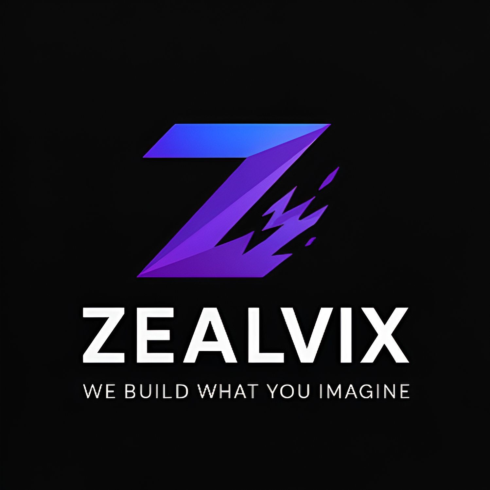

<div align="center">



# ZEALVIX®

### We Build What You Imagine.

#### Strategic Digital Growth • Web Development • Branding • SEO • AI Solutions

[](https://zealvix.in)
[]
[]
[]

---

### Building Digital Experiences That Drive Business Growth

</div>

---

# 🚀 About Zealvix

**Zealvix®** is a strategic digital growth company focused on building modern digital products, powerful brands, scalable web platforms, and intelligent business solutions.

Our mission is simple:

> **We don't just build websites. We build businesses.**

From startups to established companies, Zealvix helps brands establish a powerful online presence through technology, design, and digital strategy.

---

# 🌍 Vision

To become one of India's leading digital innovation companies by creating impactful products that empower businesses through technology.

---

# 🎯 Mission

Deliver world-class digital solutions that combine creativity, strategy, and engineering to help businesses grow faster.

---

# 💼 Services

## 🌐 Web Development

- Business Websites
- Portfolio Websites
- Landing Pages
- E-Commerce Solutions
- Enterprise Applications
- Custom Dashboards

---

## 🎨 UI / UX Design

- Product Design
- Wireframing
- User Research
- Prototyping
- Design Systems
- Responsive Interfaces

---

## 📈 Search Engine Optimization

- Technical SEO
- On-Page SEO
- Local SEO
- Website Audits
- Performance Optimization
- Content Strategy

---

## 🚀 Branding

- Logo Design
- Brand Identity
- Brand Strategy
- Marketing Assets
- Social Media Branding

---

## 📱 Digital Marketing

- Social Media Marketing
- Lead Generation
- Performance Marketing
- Content Marketing
- Business Growth Strategy

---

## 🤖 AI & Automation

- AI Integrations
- Workflow Automation
- Chatbots
- Data Analytics
- Business Automation

---

# ⚡ Why Zealvix?

✔ Modern Technology

✔ Clean User Experience

✔ SEO Optimized Solutions

✔ High Performance Websites

✔ Mobile First Development

✔ Scalable Architecture

✔ Business-Oriented Approach

✔ Long-Term Support

---

# 🛠 Technology Stack

### Frontend

- HTML5
- CSS3
- JavaScript
- React
- TypeScript
- Tailwind CSS

### Backend

- Node.js
- Express.js
- PHP

### Database

- MySQL
- Firebase
- MongoDB

### CMS

- WordPress
- Shopify

### Design

- Figma
- Canva
- Adobe Creative Suite

### Deployment

- Netlify
- Vercel
- GitHub Pages
- Cloudflare

---

# 📂 Project Structure

```
.
├── assets/
├── images/
├── index.html
├── style.css
├── script.js
├── robots.txt
├── sitemap.xml
├── favicon
└── README.md
```

---

# ✨ Features

- Responsive Design
- Premium UI
- Interactive Animations
- SEO Optimized
- Accessibility Friendly
- Performance Optimized
- Contact Form
- Dark / Light Theme
- Modern Branding
- Cross Browser Support

---

# 🚀 Getting Started

Clone the repository

```bash
git clone https://github.com/yourusername/zealvix.git
```

Navigate to the project

```bash
cd zealvix
```

Run locally

```bash
Open index.html
```

or

```bash
Live Server
```

---

# 🌐 Live Website

### https://zealvix.in

---

# 📱 Responsive Support

- Desktop
- Laptop
- Tablet
- Mobile

---

# 👨‍💼 Founder

<div align="center">


## Ranjith Sivashanmugam

**Founder & Strategic Lead**

*"Technology should create opportunities, not complexity."*

</div>

---

# 🏢 Company Philosophy

At Zealvix, every project begins with understanding the business—not just the code.

We focus on creating products that solve real problems, improve customer experiences, and generate measurable business outcomes.

---

# 📈 Roadmap

- AI Product Development
- SaaS Platforms
- Enterprise Solutions
- Mobile Applications
- Cloud Services
- Automation Tools
- International Expansion

---

# 🤝 Work With Us

We're always interested in collaborating with:

- Startups
- Entrepreneurs
- Small Businesses
- Agencies
- Enterprises

Whether you need a website, branding, SEO, automation, or a complete digital strategy—we're ready to help.

---

# 📬 Contact

**Website**

https://zealvix.in

**Email**

team.zealvix@gmail.com

**Phone**

+91 76039 63193

**LinkedIn**

https://linkedin.com/in/ranjith-sivashanmugam-800b50288

---

# © Copyright Notice

Copyright © 2026 **Zealvix®**. All Rights Reserved.

The Zealvix name, logo, visual identity, branding, website content, source code, graphics, documentation, business strategy, and associated intellectual property are the exclusive property of **Zealvix**.

Unauthorized copying, reproduction, redistribution, modification, reverse engineering, or commercial use of any part of this repository without prior written permission from Zealvix is strictly prohibited.

This repository is provided for demonstration and portfolio purposes only unless otherwise stated.

---

# 📜 License

**Proprietary License**

This software is licensed exclusively to Zealvix.

Permission is **NOT** granted to:

- Copy the source code
- Redistribute the project
- Sell or sublicense the software
- Modify and republish
- Use the branding or logo
- Create derivative commercial works

For licensing inquiries:

📧 team.zealvix@gmail.com

---

<div align="center">

## ⭐ Zealvix®

### We Build What You Imagine.

Made with ❤️ in India

</div>
